## 前言

本科最后一学期上了 **Modern Compiler Construction**（COMP 4121）[^1]。整门课基本就是用 Scala 给一门叫 **Amy** 的小型函数式语言写编译器，从源代码一路写到 WebAssembly。

这个系列是我上完课后重新消化的笔记，不按作业顺序复述课程内容。之后研究生阶段大概率还会上一门偏优化的编译器课，到时候会接着往后端写。

我觉得编译器/编译原理里面真正要理解的问题是这一个：

> 一段文本怎样一步步获得结构、绑定和类型，最后变成机器能跑的东西？每一步换了表示，程序的意思怎样保持不变？

后面每一篇基本都在回答它的某一部分。

## 同一行代码，三层意思

看到 `1 + 2 * 3`，人会直接算出 7。编译器得分三次看它：

- **语法**：结构是什么？按优先级是 `1 + (2 * 3)`。
- **静态语义**：它合不合法？操作数是不是 `Int(32)`、变量有没有定义。这些不用运行就能判断。
- **动态语义**：真跑起来会怎样？按什么顺序求值，结果是什么，会不会出错。

后两层可以用两个记号区分：

$$
\Gamma \vdash 1 + 2 : \operatorname{Int}(32) \qquad\qquad 1 + 2 \Downarrow 3
$$

左边说"它的类型是 `Int(32)`"，右边说"它算出来是 3"。这两件事要分开看。通过类型检查的程序照样可能除以零、`match` 不到任何分支，或者直接 `error("...")`。类型检查器只保证它检查的那些规则成立。

## 从 Amy 到 WebAssembly

整条流水线长这样：

```mermaid
flowchart LR
    SRC["Source<br/>源代码"]
    TOK["Tokens<br/>词法单元"]
    NOM["Nominal AST<br/>名称语法树"]
    SYM["Symbolic AST<br/>符号化语法树"]
    OK["Checked AST<br/>类型检查完成"]

    WAT[".wat<br/>WebAssembly 文本"]
    WASM[".wasm<br/>WebAssembly 二进制"]
    RUN["Execution<br/>运行"]

    INTERP["Direct Execution<br/>解释执行"]

    SRC -->|"Lexer · 词法分析"| TOK
    TOK -->|"Parser · 语法分析"| NOM
    NOM -->|"Name Resolution · 名称解析"| SYM
    SYM -->|"Type Checking · 类型检查"| OK

    OK -->|"CodeGen · 代码生成"| WAT
    WAT -->|"wat2wasm · 汇编"| WASM
    WASM -->|"Wasmtime · 执行引擎"| RUN

    OK -.->|"Interpreter · 解释器"| INTERP

    classDef source fill:#F3F0E9,stroke:#B9B0A2,color:#5C5348,stroke-width:1.5px
    classDef ast fill:#E5EDF3,stroke:#8FA8BC,color:#344F63,stroke-width:1.5px
    classDef checked fill:#365C70,stroke:#365C70,color:#FFFFFF,stroke-width:2px
    classDef wasm fill:#F2E7DF,stroke:#C8A48D,color:#805B45,stroke-width:1.5px
    classDef execute fill:#E3EDE5,stroke:#8EAA94,color:#3F634B,stroke-width:1.5px

    class SRC source
    class TOK,NOM,SYM ast
    class OK checked
    class WAT,WASM wasm
    class RUN,INTERP execute

    linkStyle default stroke:#9BA5A9,stroke-width:1.5px
```



课程里 Interpreter 是 Project 1，最先写，但它并不跳过前端。实验直接给了一个编译好的前端 jar，解释器拿到的已经是检查过的 AST[^2]。先写解释器是为了先搞清楚 Amy 的程序是什么意思，之后再去考虑怎么把它编译出来。

这是一个示例程序:

```scala
object Demo
  def twicePlusTwo(x: Int(32)): Int(32) :=
    val y: Int(32) = x + 1;
    y * 2
  end twicePlusTwo

  Std.printInt(twicePlusTwo(20))
end Demo
```

输出 `42`。中间发生了这些事：

**Lexing**：把字符切成 token。`def` 是关键字，`x` 是标识符，`20` 是整数字面量，空白和注释在这里就扔掉了。这一步还不知道 `x` 指向谁。

**Parsing**：按文法把 token 排成树。函数体可能是长成这样：

```text
Let(y: Int(32))
├── value: Add(Var(x), 1)
└── body:  Mul(Var(y), 2)
```

Amy 里的 `val y = ...; ...` 本身就是一个表达式，`;` 是序列运算符，不能像 C 那样在语句末尾随手加。`y` 只在分号后面的部分可见[^3]。这种细节决定了 parser 最后建出一棵什么样的树。

**Name Analysis**：parser 只认识字符串。名称解析要回答"这个 `x` 到底是哪个 `x`"。看这个合法的函数：

```scala
def bump(x: Int(32)): Int(32) :=
  val x: Int(32) = x + 1;
  x
end bump
```

`x + 1` 里的 `x` 是参数，最后一行的 `x` 是新定义的局部变量，也就是 shadowing。光比较字符串分不出这两个，所以 Amy 会把 Nominal AST 里的名字换成各有身份的 Identifier，得到 Symbolic AST[^4]。

**Type Checking**：名字定下来，类型才好检查：

$$
\frac{\Gamma \vdash x : \operatorname{Int}(32) \qquad \Gamma \vdash 1 : \operatorname{Int}(32)}
     {\Gamma \vdash x + 1 : \operatorname{Int}(32)}
$$

Amy 明明要求处处写类型标注，课程的类型检查器内部用的却是简化版的 Hindley–Milner：遍历 AST 生成形如 `T1 = T2` 的约束，再做 unification。因为 Amy 没有高阶函数，也没有泛型 ADT，约束里不会出现复合类型，unification 写起来很简单[^4]。

**Code Generation**：最后一步要在目标机器上把程序的意思实现出来。Wasm 是栈机，`1 + 2` 大概就是：

```wat
i32.const 1
i32.const 2
i32.add      ;; [] → [1] → [1, 2] → [3]
```

真正生成函数的时候还得处理局部变量的编号、调用约定、ADT 在内存里怎么摆、怎么接上 `Std` 的运行时函数。这部分是课程PA里工作量较多的一块[^5]，期末的时候考的手写WASM我也没写对TAT。

## 为什么要分阶段

分 phase 当然方便拆文件，但更有用的是：每过一个阶段，后面的阶段就能少操心一类问题。

| Phase         | 之后可以默认的事               |
| :------------ | :----------------------------- |
| Lexer         | 输入是合法 token，带着源码位置 |
| Parser        | 结构明确，没有语法错误         |
| Name Analyzer | 每个引用都指向一个确定的定义   |
| Type Checker  | 满足 Amy 的类型规则            |

所以这三种错误会在不同阶段报出来：

```scala
1 +              // 语法错误
unknownVar + 1   // 名字错误
true + 1         // 类型错误
```

类型检查器不用去猜某个名字指向谁，代码生成器也不用再判断 `true + 1` 合不合法。每一层只负责自己那件事，出了 bug 也比较好定位。

工业编译器当然没这么整齐，经常合并阶段，或者在好几层 IR 之间反复 lowering。不过这个思路是通用的：每层表示负责建立一些不变量，下一层就可以直接拿来用。

## 解释器和编译器应该得到同一个答案

解释器沿着 AST 走，用一个环境记录变量的值，边走边算。编译器则先生成一个目标程序，交给别人去跑。两种方式都应该符合同一套语义：

$$
\operatorname{Obs}(\operatorname{Interpret}(P)) = \operatorname{Obs}(\operatorname{Execute}(\operatorname{Compile}(P)))
$$

$\operatorname{Obs}$ 指可观察的行为，主要是输出和最终结果。这条式子只是直觉，严格说起来还得定义清楚溢出、运行时错误、IO 这些边界情况。

但它在调试的时候真的有用。解释器打印 42，Wasm 打印 41，那就是代码生成哪里把程序的意思改了，顺着去找就行。所以我更愿意把编译器理解成一个保持语义的变换：表示可以换来换去，意思不能变。后面讲优化，说的也是这件事，只是多了一个要求：变换完之后程序还得更快。

## 为什么用 Scala 写

主要因为程序本来就是递归的树，ADT 加模式匹配写起来最顺手：

```scala
enum Expr:
  case Lit(value: Int)
  case Add(lhs: Expr, rhs: Expr)
  case Mul(lhs: Expr, rhs: Expr)

import Expr.*

def eval(e: Expr): Int = e match
  case Lit(n)    => n
  case Add(l, r) => eval(l) + eval(r)
  case Mul(l, r) => eval(l) * eval(r)

assert(eval(Add(Lit(1), Mul(Lit(2), Lit(3)))) == 7)
```

有哪些节点，类型定义里写得一清二楚。每加一种操作，不管是求值、打印、常量折叠还是代码生成，都是再写一个 `match`。哪天漏了一个分支，编译器会提醒你。数据不可变也让阶段之间更干净，前一个 phase 不会偷偷改掉后一个 phase 要用的节点。

代价就是经典的 Expression Problem：加操作很容易，加节点就得把所有 `match` 都改一遍。所以 Visitor 模式也不是一无是处。

Lexer用的是 EPFL 的 **Ziplex**。Parser 用的是 EPFL 的 **Scallion**，一个 LL(1) parser combinator 库，背后的算法是 derivatives 加 zipper[^6]。

## 后面打算写什么？

主要有两部分，大部分会是AI帮我写，不一定有时间。

**前半段：从语言定义到能跑的实现。** 也就是 Amy 这条线：语义和解释器、词法分析、LL(1) 与 parser combinator、名称解析、类型检查和 unification、Wasm 代码生成。每篇都会讲清楚这一层吃进什么、吐出什么、给后面保证了什么。

**后半段：让实现变快。** 这部分4121只是几节课匆匆带过讲了一大堆概念，研究生如果上PL课就写。大概包括：

- 从 AST 到 CFG、SSA，看清楚为什么优化几乎都做在 IR 上而不是语法树上；
- Dataflow Analysis 和格（lattice）理论，以及它和抽象解释的关系；
- 寄存器分配、指令选择？；
- LLVM / MLIR 这种多层 IR 的设计，e-graph 和 equality saturation;
- 如果硕士毕业之前来得及就记一下ML Compiler和类型理论这些.

## 后记

这是我本科最后一学期最喜欢的课。部分材料继承自 EPFL Viktor Kunčak 的课程[^1]，风格和我原先想的那种"编译器课 = 龙书 + 机器级优化"很不一样，它更在意一门语言怎么从形式定义落到实现上。上完有种被 PL 圈传教了的感觉。龙书确实得看，只是这套比较现代化的 Scala、ADT、类型系统理论和 Wasm ~~串起来看就很有X格~~.

FP 一直有点"学院派"或者"小众宝藏"的名声，不过 Java 8 之后，lambda、模式匹配、不可变数据已经到处都是了。纯 FP 的未来怎么办，只有天知道。但在编译器这种到处都是树的地方，这套东西确实好用。

~~副作用是上完课以后看什么都想先定义个 ADT，然后写一串 transformation，最后莫名其妙地想 Rewrite It In Rust。就很...~~ 豪到你了吗

---

[^1]: HKUST COMP 4121, _Modern Compiler Construction_, Spring 2026. [课程主页](https://hkust-taco.github.io/mcc/) · [实验目录](https://hkust-taco.github.io/mcc/labs/)

[^2]: [Project 1: An Interpreter for the Amy Language](https://hkust-taco.github.io/mcc/labs/project1-interpreter)

[^3]: [Specification of the Amy Language](https://hkust-taco.github.io/mcc/labs/amy-spec)

[^4]: [Project 4: A Type Checker for the Amy Language](https://hkust-taco.github.io/mcc/labs/project4-type-checker)

[^5]: [Project 5: Code Generation for the Amy Language](https://hkust-taco.github.io/mcc/labs/project5-code-generation)

[^6]: Edelmann, Hamza & Kunčak. _Zippy LL(1) Parsing with Derivatives_. PLDI 2020. [DOI](https://doi.org/10.1145/3385412.3385992) · [Scallion](https://github.com/epfl-lara/scallion)
