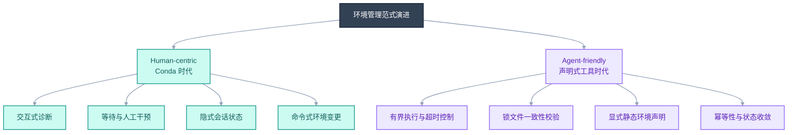
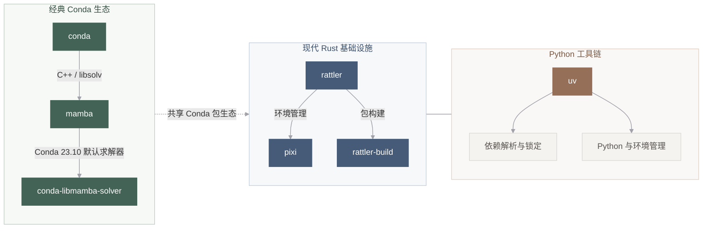

## 前言

这几年豪情满天的Rust社区把开发工具链里面的很多关键工具轮子都用现代标准重新搓了一遍（Rewrite It In Rust, RIIR）。虽然我们完全可以用20年代初的那些教程里面的开发工具链和包管理工具来搭建自己的开发环境，但是看到~~小众~~潮酷的那些现代特性和性能提升，谁能忍住不去找一份最佳实践来取悦自己呢？尽管根据笔者乐观预计，到了2027年及以后，AI agent的配置环境能力将会彻底超越一般工程师，但是对环境管理的品味和最佳实践的选择仍然是因人而异。在这个工具链快速迭代和所谓 `Agent Native` 的浪潮下，确有必要记载一套好用好看的配置方法，故有此文。感谢 `Gemini 3.8 & Claude Sonnet 5.5` 帮忙打草稿和绘图，虽然你们现在的文笔真的很烂XD。

---

## Conda 之后：使用者从人类变成了 Agent

### 为什么 Conda 是领域内的神？

在数据科学与生物信息学领域，Conda 曾经几乎是唯一能够交付“全栈科学计算”的基础设施。Xiaofei 老师的文章讨论了 Conda 在科研工作流中的价值及其局限[^1]。结合这些讨论，笔者将其优势归纳为以下三点：

1. **统一用户态的异构分发**：Python 社区的 `pip` 长期难以优雅解决包含底层 Fortran、C/C++、OpenBLAS 等非 Python 原生二进制的编译依赖问题。Conda 将编译器运行时、系统动态库、Python 解释器与上层库视作同一层级的包统一打包。
2. **免 Root 权限的科研计算沙盒**：在多租户（Multitenancy）的 HPC 集群上，普通用户缺乏 `sudo` 权限，且全局`base`环境往往难以改动[^1]。Conda 允许用户在 `$HOME` 目录下建立自包含的环境树，绕过操作系统级包管理器的制约。
3. **领域生态聚合**： Conda-forge 社区 沉淀了上万个跨语言二进制配方，生信领域的Bioconda 收录了超过 9000 个生物信息学工具[^1]，使得复杂的下游分析流程（Python 胶水 + C 比对工具 + R 统计画图）可以通过单一命令拉取。

### 生态的技术演变路径

以下 Conda 生态演变的梳理参考了 Xiaofei 老师的文章[^1]，并加入 uv，便于比较不同工具的职责。

Conda 的核心痛点在于早期的单线程 Python SAT 求解器速度慢如蜗牛，以及基于命名环境的设计导致的可复现性偏弱。随着 Rust 等现代化系统编程语言的介入，包管理生态发生了一次结构性重构：

- **求解器革新**：`mamba` 引入基于 C++ 的 `libsolv`，解决了复杂依赖求解导致进程“卡死”假象的问题；后续 Conda 官方将其纳入默认配置。
- **协议底层重写**：`rattler`[^2] 用 Rust 完全剥离了 Conda 对 Python 解释器本身的自举依赖，把元数据解析、SAT 求解、并行下载与文件解包做成了高性能的底层库。
- **边界清晰化**：
- **uv**：专注纯 Python 依赖。接管解释器下载、虚拟环境、PEP 508 依赖解析与工具链执行，具备极致的并发写安全与硬链接缓存优化[^3]。
- **Pixi**：建立在 `rattler` 之上的跨语言、多平台项目级包管理器。不仅处理 Python 包，还将系统二进制、CUDA 驱动虚拟约束与 R 工具链纳入声明式清单。

### Agentic Programming 时代的硬性指标

当写代码与管理环境的主体从**拥有容错直觉的人类**转变为**自动化 Agent** 时，对工具链的评价指标已然改写：

| 评价维度         | 传统交互模式（面向人类）            | Agent-Native 模式（面向自动化代理）                      |
| ---------------- | ----------------------------------- | -------------------------------------------------------- |
| **状态载体**     | 宿主全局状态 / 人脑记忆中的环境名   | 严格版本受控的清单文件（`pixi.toml` / `pyproject.toml`） |
| **执行模式**     | 交互确认（Prompt `Proceed [y/n]?`） | **绝对非交互与幂等收敛**                                 |
| **运行时保护**   | 开发者随时观察状态并按 `Ctrl-C`     | 默认加锁只读校验（`--locked` / `--frozen` 防止隐式修改） |
| **故障面**       | 容忍半安装状态，人工手动修剪        | **写安全与原子性保证**，进程被 SIGKILL 后可自愈          |
| **多节点一致性** | 手动执行脚本同步环境                | 跨平台全局 Lockfile 保证求解结果唯一                     |

> **深入思考：为什么 `--locked` 对 Agent 至关重要？**
> 默认情况下，许多现代工具在检测到配置变动时会自动刷新锁文件并拉取最新依赖。对于需要稳定复现的 Agent 任务，这会带来不可控的状态漂移。显式传入 `--locked`（或通过环境变量 `PIXI_LOCKED=1`）可以保证：当且仅当现有 Lockfile 完全吻合时才运行，任何清单偏差都会直接以非零状态码退出，便于 Agent 捕捉并按既定策略决策。

---

### 参考与延伸阅读 (References)

[^1]: Zang, X. C. (2026). _Switching from conda to pixi_. [文章](https://x-zang.github.io/blog/switch-from-conda-to-pixi/)详述了生物信息学工作流从传统 Conda/Mamba 迁移到 Pixi 的工程动因，重点分析了 Bioconda 生态依赖、命名环境在多用户服务器上的维护痛点，以及项目制声明式管理的优势。

[^2]: Rattler Project. _Rattler: Rust library for the conda ecosystem_. conda 官方组织孵化项目，为 Pixi 提供了无 Python 依赖的底层包解析与环境安装能力。

[^3]: Astral. _uv: Unified Python packaging in Rust_. 官方文档详述了跨平台 Wheel 缓存机制与无竞争并发文件锁机制。
