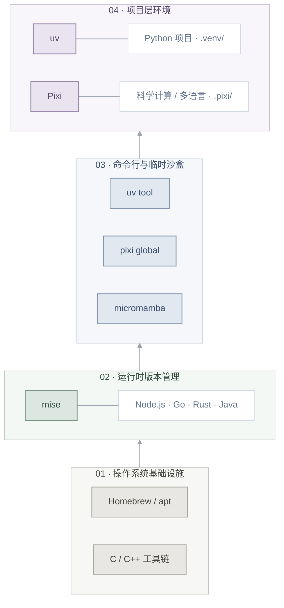

## 前言

目前这种环境配置方案的时效性很强，如果你在2027年以后读到这里建议不要直接照搬，毕竟当下的生态只能算是agent-friendly 而不是agent native。
下面的使用场景涉及使用多种不同编程语言的纯软件开发，但是基本都是轻资产的场景，笔者目前对游戏开发/嵌入式/硬件设计了解不深，所以可能这份经验用不上。

---

## 工具选型与日常工作流：mise、uv、Micromamba、Pixi

### 架构分层：职责单一原则

笔者有一台 M1 Pro 的MacBook，从高中毕业起一直用到现在。很多开发者的机器，特别是从学生时代一路用过来的机器，之所以变成环境屎山，核心在于工具职责越界。例如同时使用 `conda` 与 `pip` 管理同一个 Python 项目的依赖。解决冲突的唯一途径是**确立清晰的分层边界**。如果你去各个管理工具软件的官网看，其实很多工具都是**可以胜任**另外一件工具的工作的，但是这里需要权衡（trade-off）的是软件工具数量的心智负担和环境混乱程度（熵）的心智负担。一个经典的比喻是厨具界的两个极端：一把中式菜刀 VS 一整套十几把西式菜刀。如果没有个人癖好那最好还是选一个折中的组合方案。



### 基础环境初始化

这里只保留最有代表性的命令，具体安装方式、架构兼容和参数最好还是看官方的 latest 文档，尤其别把几年以前的 `curl | sh` 当圣旨。

#### macOS（Homebrew 作为主要管理）

对于个人 Mac，先准备 Xcode Command Line Tools 和 Homebrew：

```bash
xcode-select --install
# Homebrew 的安装命令请直接从 https://brew.sh/ 获取
```

之后把常用工具交给 Homebrew 管理即可：

```bash
brew install git mise uv pixi

# 有conda 风格环境的使用/兼容需求时再装
brew install micromamba
```

注意：`mise`、`uv`、`Pixi` 各自也提供独立安装方式。Homebrew 胜在统一升级，官方安装器则可能更早拿到新版本。**同一个工具最好只选择一种安装渠道**，不然 PATH 里的多个同名可执行文件迟早会坑死自己。

- [Homebrew 官方网站](https://brew.sh/)
- [mise 安装文档（latest）](https://mise.jdx.dev/installing-mise.html)
- [uv 安装文档](https://docs.astral.sh/uv/getting-started/installation/)
- [Pixi 安装文档（latest）](https://pixi.sh/latest/installation/)
- [Micromamba 安装文档（latest）](https://mamba.readthedocs.io/en/latest/installation/micromamba-installation.html)

#### Linux（Debian/Ubuntu 系；区分有 Root 和无 Root）

如果有 `sudo` 权限，可以先用系统包管理器安装基础构建工具：

```bash
sudo apt update
sudo apt install -y build-essential git curl ca-certificates pkg-config
```

如果没有 Root 权限，例如实验室服务器或学校的远程机器，`mise`、`uv`、`Pixi` 都有用户态安装方式，不必为了安装开发工具去折腾系统 Python。下面仅给出入口，实际运行前建议自己先看一眼官方安装脚本。

- [mise 官方安装方式](https://mise.jdx.dev/installing-mise.html)
- [uv 官方安装方式](https://docs.astral.sh/uv/getting-started/installation/)
- [Pixi 官方安装方式](https://pixi.sh/latest/installation/)
- [Micromamba 官方安装方式](https://mamba.readthedocs.io/en/latest/installation/micromamba-installation.html)

```bash
# 用户级独立安装示意（按需选择）
curl -fsSL https://mise.run | sh
curl -LsSf https://astral.sh/uv/install.sh | sh
curl -fsSL https://pixi.sh/install.sh | sh
"${SHELL}" <(curl -L micro.mamba.pm)
```

安装工具本身和项目环境是否能复现是两回事。共享 Linux 服务器上的网络限制、Home 配额和文件系统布局会直接影响缓存与安装性能，这部分之后再说。

#### Shell 配置（`~/.zshrc` 或 `~/.bashrc`）

这里需要灵活变通一点，真的不能照抄，最好是自己折腾完之后找AI核对确认一遍。

将以下配置添加到对应的 Shell 启动文件中，统一管理工具路径和 mise 环境激活。注意：如果官方安装器已经添加了 PATH，就没必要重复写好几份。

```bash
# 1. 用户态工具目录
export PATH="$HOME/.local/bin:$HOME/.pixi/bin:$PATH"

# 2. 激活 mise Shell 集成（动态管理工具版本与环境变量）
if command -v mise >/dev/null 2>&1; then
    if [ -n "${ZSH_VERSION:-}" ]; then
        eval "$(mise activate zsh)"
    elif [ -n "${BASH_VERSION:-}" ]; then
        eval "$(mise activate bash)"
    fi
fi
```

**配置说明：**

- **PATH**：使通过用户级安装方式部署的 uv、Pixi 等工具可以直接调用。碰到 `command not found` 时，先检查安装位置和 `command -v`，不要不分青红皂白追加十行 PATH。
- **mise**：通过 Shell Hook 根据当前目录和项目配置动态管理工具版本。与基于 Shim 的机制不同，`mise activate` 主要用于交互式 Shell。非交互式脚本可以直接使用 `mise exec`。
- **缓存目录**：对于个人电脑，我现在更倾向于先使用默认值，不必在每份 Dotfiles 里写死路径。确实需要自定义时再使用 `UV_CACHE_DIR`、`PIXI_CACHE_DIR` 等环境变量。

如果你的 Shell 启动文件已经比较复杂，建议参考 [mise 官方 Shell 配置](https://mise.jdx.dev/shell-setup.html)，而不是反复叠加不同教程里的初始化片段。

对于已经熟悉于conda, mamba 等工具的老~~牢~~同学，建议添加以下别名减少心智负担：

```bash
alias conda="micromamba"
alias mamba="micromamba"
# 比如下面这个就是用新工具无感替换老工具的例子
# alias ls='eza --group-directories-first --icons=auto --color=auto'

```

#### mise：让运行时版本跟着项目走

在这套方案里，`mise` 负责选择和管理除了`python`以外绝大部分开发工具和语言运行时的版本。很多语言都有自己的“多版本运行时管理器”，但是Mise可以取代它们。比如java/JDK (干掉`sdkman`), `maven`/`gradle`，Scala/`sbt`, go, rust, ruby, node.js (干掉`nvm`/`fnm`)。

实际上 mise 也能管理 Python，但如果这个项目已经用 uv python pin 或 Pixi 来决定 Python 环境，就没必要再让 mise 对同一个解释器指手画脚。陌生仓库里的 mise.toml 如果包含任务、Hook 或环境变量配置，也建议先看一眼再执行或信任。

以node为例，如果只是临时需要一个版本，你甚至不必修改任何配置文件：

```bash
# 临时用 Node.js 24 执行一条命令，不改当前 Shell 和项目配置
mise exec node@24 -- node --version
```

如果是一个长期维护的项目，就应该把运行时版本写进仓库。比如在一个独立的演示目录中：

```bash
mkdir demo-runtime && cd demo-runtime

#下载/安装 Node.js 24，并在项目配置里声明它

mise use node@24

# 查看当前目录使用的工具及实际可执行文件

mise ls --current
mise which node

# 已按上文激活 mise 的交互式 Shell，可以直接用

node --version

# 在脚本、CI 或没有加载 Shell Hook 的场景，显式执行更稳妥

mise exec -- node --version
```

执行 `mise use` 后，通常会得到一个很简单的 `mise.toml`：

```xml
[tools]
node = "24"
```

下次从 Git 克隆这个项目，在项目目录执行 `mise install` 就可以安装清单声明的工具。需要注意：`node = "24"` 固定的是 24 这个主版本系列，不是某个精确的补丁版本。如果项目对工具链版本一致性比较敏感，可以额外生成 `mise.lock`：

```bash
# 在已经有 mise.toml 的项目中

mise lock
mise install --locked
```

把 mise.toml 和 mise.lock 一起提交即可。它锁定的是 mise 管理的工具版本，并不能取代 Node 项目的依赖锁文件，更不能取代 uv.lock、pixi.lock。
另外，`mise use --global node@24` 可以设置个人机器上的默认 Node.js 版本；项目自己的 `mise.toml` 则可以覆盖这个默认值。笔者更倾向于全局只放个人常用工具，项目版本尽量写在仓库里，不然换一台电脑就又得猜当年到底装了什么。

官方补充：[mise Getting started](https://mise.jdx.dev/getting-started)、[Dev tools 与常用命令](https://mise.jdx.dev/dev-tools/) 、[mise.lock](https://mise.jdx.dev/dev-tools/mise-lock.html)、[配置文件信任机制](https://mise.jdx.dev/cli/trust.html)。

### 项目级工程范式

**一个项目只认一个主要的环境来源**。工具能互相调用，不等于它们应该同时修改同一套依赖状态。

#### 方案 A：纯 Python 现代化工作流（以 `uv` 为基石）

```bash
# 初始化纯 Python 项目
uv init demo-service && cd demo-service
uv python pin 3.14
uv add httpx fastapi pydantic uvicorn

# 锁定与同步
# 依赖求解
uv lock
# 根据已有锁文件安装
uv sync --locked

# 在项目环境里运行命令
uv run python -c "import fastapi, httpx, pydantic; print('environment OK')"

# 写好 main.py 并定义 app 之后，可以启动服务：
# uv run uvicorn main:app --reload
```

平时使用 `uv run` 时，uv 本来也会按项目状态自动处理锁文件和环境同步，不需要每次手动跑一遍 `uv lock`。

- **Git 规范**：
  - **应该提交**：`pyproject.toml`、`uv.lock`，以及项目使用的 `.python-version`。
  - **应该忽略**：`.venv/`。

官方补充：[uv Working on projects](https://docs.astral.sh/uv/guides/projects/) 和 [Locking and syncing](https://docs.astral.sh/uv/concepts/projects/sync/)。

#### 方案 B：科学计算与多语言工作流（以 `Pixi` 为基础）

下面使用 `pixi.toml` 清单模板。Pixi 也可以集成到 `pyproject.toml`，但具体表名和命名空间不同。大概了解结构就好不要照搬，尤其涉及 PyTorch、CUDA 或特定 channel 时，平台兼容问题不是写一份 TOML 就能自动解决的。

```toml
[workspace]
name = "deep-vision"
version = "0.1.0"
channels = ["conda-forge", "bioconda"]
platforms = ["osx-arm64", "linux-64"]

[dependencies]
python = "3.14.*"
numpy = ">=2.4"
opencv = "*"
samtools = "*"

[pypi-dependencies]
httpx = "*"

[tasks]
test = "python -c 'import numpy; print(numpy.__version__)'"
run = "python train.py"
```

```bash
# 首次创建/更新锁文件
pixi lock

# 按已有锁文件安装，检查清单和锁文件是否一致
pixi install --locked

# 执行预定义任务
pixi run --locked test
```

- **Git 规范**：
  - **应该提交**：`pixi.toml`（或者集成 Pixi 配置的 `pyproject.toml`）、`pixi.lock`。
  - **应该忽略**：`.pixi/`（项目环境目录，可以根据清单与锁文件重建，但重建速度取决于缓存和文件系统，未必是毫秒级）。

官方补充：[Pixi Manifest（latest）](https://pixi.sh/latest/reference/pixi_manifest/)、[pyproject.toml 集成](https://pixi.sh/latest/python/pyproject_toml/)、[pixi install 参数](https://pixi.sh/latest/reference/cli/pixi/install/)。

#### Micromamba 到底放在哪里？

Micromamba, 又或者 mamba, 主要起到的是一个**兼容已有 conda 生态、临时启动独立环境**的作用。你完全可以认为前面的这些现代潮酷工具是在装X，用回自己熟悉的conda。但是相比Anaconda/miniconda/miniforge这些基于conda的软件，最佳实践仍然是尽可能轻量化+尽可能使用开源channel+换成更快的mamba系。

碰到别人给了一份传统的 `environment.yml`，或要快速复现旧项目时，Micromamba 可以很方便；但新项目既然已经选了 Pixi，就没必要在 `.pixi/` 里面和Micromamba互相套来套去，最后让两个工具轮流修改同一环境。`mise` 管工具版本、`uv` 和 `Pixi` 管各自项目依赖、Micromamba 处理历史遗留场景，职责明确就行。

### 日常使用与环境维护

前面介绍的 Shell 配置提供了跨平台的通用基线，但在实际使用中，环境管理的性能不仅仅取决于包管理器本身，还取决于缓存布局和任务执行方式。

GPT-6 给了个AI味很重的对齐句式：

> **配置与锁文件持久化、依赖缓存就近存储、运行环境按需重建、计算结果独立保存。**

对于本地直连 SSD 或 NVMe 工作站，通常无需额外调整缓存目录。uv 和 Pixi 的默认缓存策略已经能够满足大多数开发需求。

通过以下命令检查实际环境：

```bash
# 查看工具版本与实际路径
mise --version
uv --version
pixi --version
command -v mise
command -v uv
command -v pixi

# 查看 uv 缓存目录
uv cache dir

# 查看 Pixi 环境与配置
pixi info

# 查看 Python 实际解析路径（注意是否处于项目环境中）
command -v python
command -v python3
```

**最佳实践：**

- 保留项目级 `.venv/` 和 `.pixi/`，避免不必要的重复安装。
- 使用锁文件控制项目依赖版本，不依赖全局 Python 包。
- 通过 `uv run` 或 `pixi run` 执行项目命令，减少环境误用。
- 不建议仅为节省磁盘空间而频繁删除缓存；缓存能够显著减少重复下载与安装。

#### 缓存检查与清理

缓存有助于性能优化，但长期使用也别忘了清理。

```bash
# uv：查看缓存目录
uv cache dir

# uv：清理不再需要的缓存条目
uv cache prune

# uv：彻底清空缓存（谨慎使用）
uv cache clean

# Pixi：查看相关配置和环境信息
pixi info

# Pixi：按当前版本确认缓存清理选项
pixi clean cache --help
```

不建议将彻底清空缓存作为每日或每次作业的固定步骤，否则会失去缓存复用带来的性能收益。

这里还有一个很容易混淆的地方：**缓存目录和项目环境目录并不是同一个东西**。`UV_CACHE_DIR` 不直接决定 `.venv/` 的位置；`PIXI_CACHE_DIR` 也不直接移动项目的 `.pixi/envs/`。清理缓存和删除环境都可能带来重复安装，但它们不是同一种操作。

### 从个人工作站走向共享服务器

以上基本是个人 macOS / Linux 工作站上的日常方案，很简单吧？但是一旦把项目放进学校/实验室/公司的共享服务器、HPC 集群和 Agent 自动化运行的宿主机，考虑的事情就多了。

举个栗子，有些机器的 `$HOME` 挂在 NFS、Lustre 等共享文件系统上，可以跨机器报存工作目录，但是很慢；有的计算节点不能联外网，只能自己scp/rsync上去；还有的任务跑了几个小时后会被调度器或 Agent 强制终止。此时即使 `pixi.lock` 或 `uv.lock` 完好，也未必意味着运行环境已经满足宿主机、存储和进程生命周期的所有约束。

后续文章会继续讨论 **CUDA/ABI、共享 Scratch、Slurm，以及 Agent 进程被 SIGKILL 后如何重建环境**。这种知识太占脑子内存了。真要上集群的时候，再按实际平台和管理员文档处理现场给agent注入知识就好了。

---

### 参考与延伸阅读（References）

- [mise Getting started](https://mise.jdx.dev/getting-started)
- [uv Projects](https://docs.astral.sh/uv/guides/projects/)
- [Pixi Documentation（latest）](https://pixi.sh/latest/)
- [Micromamba Installation（latest）](https://mamba.readthedocs.io/en/latest/installation/micromamba-installation.html)

- Zang, X. C. (2026). [Switching from conda to pixi](https://x-zang.github.io/blog/switch-from-conda-to-pixi/)。本文关于 Pixi 全局工具与缓存目录的讨论参考了这篇文章。

- mise-en-place. [mise Documentation: Polyglot tool version manager](https://mise.jdx.dev/)。详述了 mise 的版本管理、Shell 集成及与其他环境工具共存的方式。
