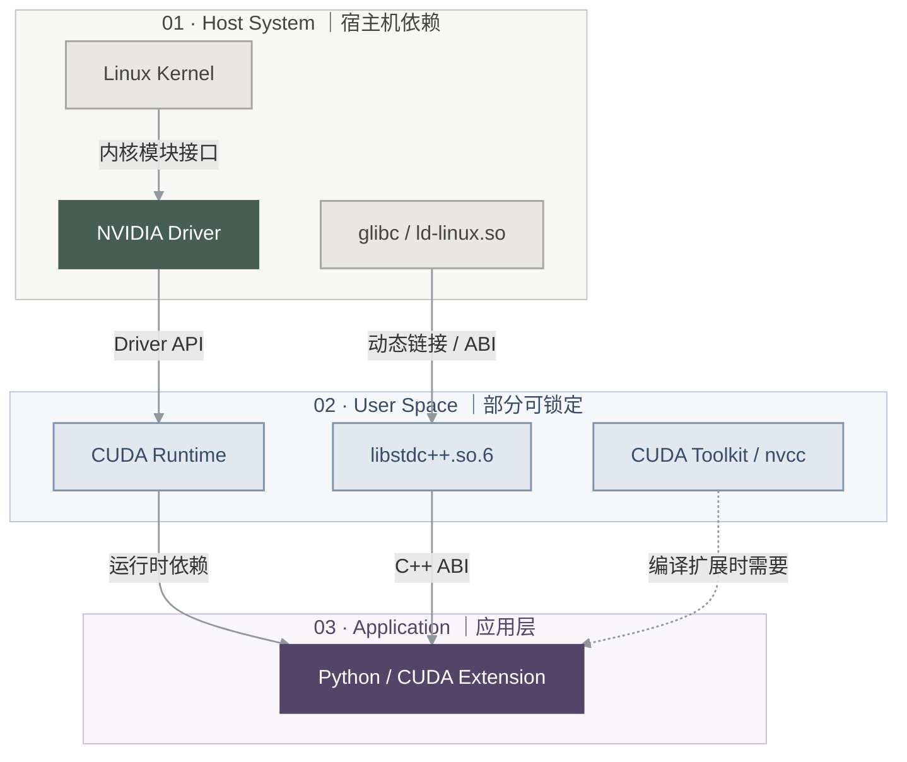
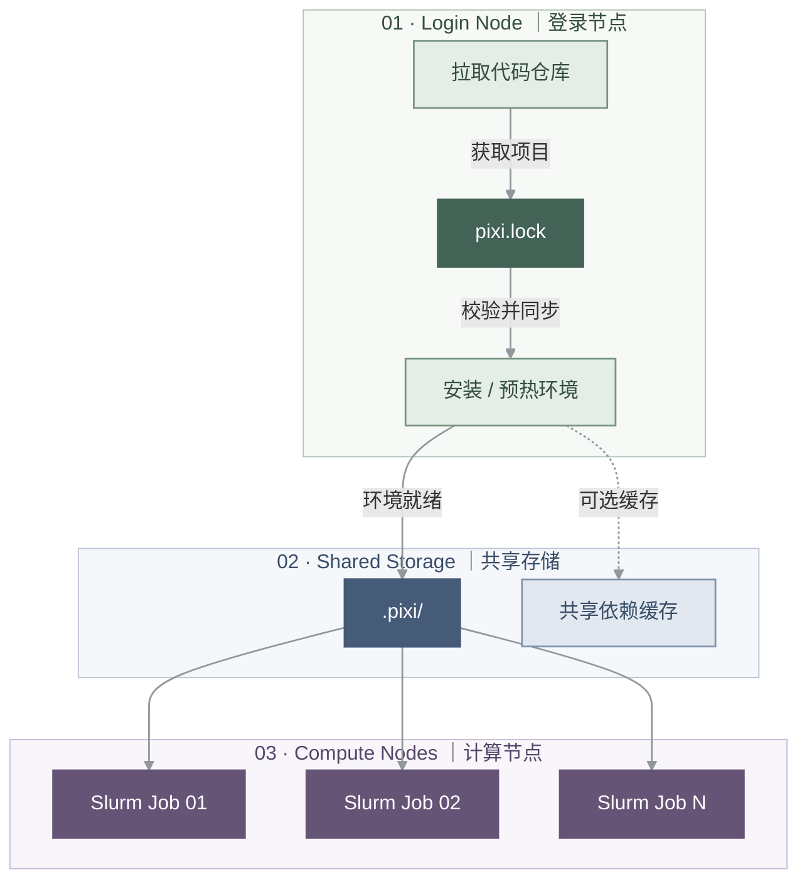
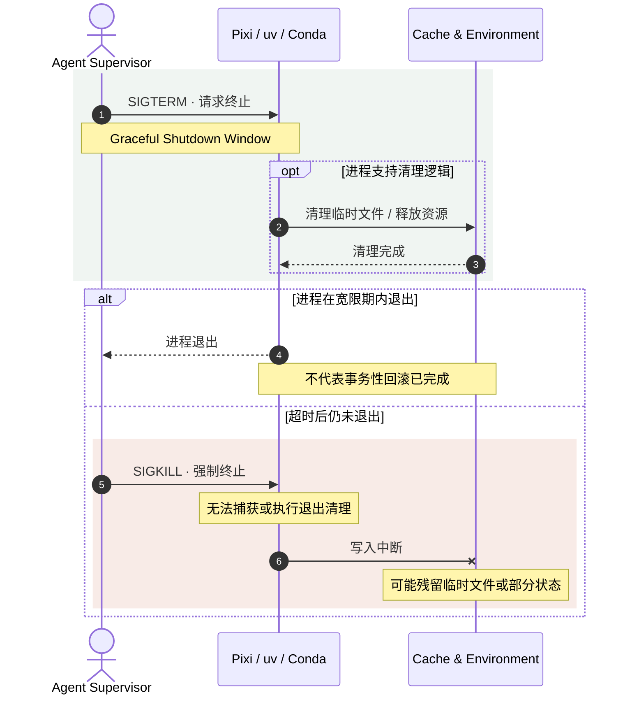

## 前言

上一篇文章主要讨论如何在 macOS / Linux 上安装环境工具、管理项目依赖以及维护缓存。到这里为止，似乎只要提交了 `uv.lock` 或 `pixi.lock`，别人就能复现你的工作环境。

但是经常复现别人代码的孩子都知道：**依赖可求解、环境可安装、程序能运行**其实是三个不同的挑战。特别是还要在特定 GPU 服务器、HPC 集群和 Agent 自动执行场景中。想要配置好环境其实很多东西已经超出包管理器的控制边界之外，造成额外的精神伤害。下面从宿主机、共享文件系统与进程生命周期三个角度讨论。

---

### 求解成功的假象：包管理器与宿主机的边界

包管理器的依赖求解，从算法上看是一个[布尔可满足性问题](https://en.wikipedia.org/wiki/Boolean_satisfiability_problem)（boolean SATisfiability problem,SAT）。包管理器一版会内置一个求解器（SAT Solver）。但是能够算出来一个解，只能证明一件事：**在包索引元数据所描述的依赖图里，存在满足版本与平台约束的候选组合**。真实的运行时仍然受制于操作系统内核、动态链接器以及驱动栈的强约束。



#### 常见 CUDA / ABI 诊断表

下面这个表是一些常见报错。题外话：GPT 5.5 - 6.1 的几个版本在目前往往被认为“过度严谨”，“过度防御性”，“过度保守谨慎”。所以特别擅长设计执行“进一步验证”类型的分析和测试。不知道是不是因为针对解决前沿数学问题导致的bias injection。

| 报错现象                                 | 常见诱因                                      | 需要进一步验证的地方                                                                               |
| ---------------------------------------- | --------------------------------------------- | -------------------------------------------------------------------------------------------------- |
| `CUDA driver version is insufficient...` | 宿主机驱动与应用要求不兼容                    | 核对 Driver、CUDA Runtime 和框架的实际版本组合                                                     |
| `torch.cuda.is_available() == False`     | CPU-only 安装、驱动不可用、GPU 未分配等       | 先检查 `nvidia-smi`，再确认 PyTorch 构建及设备可见性；不能只凭一个返回值断言求解器回落了 CPU Wheel |
| `GLIBCXX_3.4.xx not found`               | 运行时加载到的 `libstdc++` 不满足所需符号版本 | 检查实际动态链接路径、工具链与 `LD_LIBRARY_PATH`，不一定是系统库单方面的问题                       |

Pixi 的锁文件能够描述项目依赖，但不能替代宿主机驱动、GPU 资源及系统 ABI 的兼容性检查。

在 GPU 节点上，可以先检查：

```bash
# 检查 GPU 驱动与设备
nvidia-smi

# 检查系统与平台
uname -m
ldd --version  # Linux/glibc 系统；macOS 不适用
```

需要区分：

- NVIDIA Driver：由宿主机或集群管理员提供，内核驱动与用户态组件共同影响兼容性。
- CUDA Runtime：可能由项目环境或框架的二进制依赖提供。
- CUDA Toolkit：包含 `nvcc` 等编译工具，是否需要取决于具体工作负载。
- GPU 计算能力：决定相关预编译二进制和内核是否支持当前硬件。

**最佳实践：** 对于 CUDA 项目，还应记录驱动要求、目标 GPU 架构及必要的系统运行条件。正所谓配置文件也有文档属性。

```toml
# 片段示意，需放入实际 pixi.toml 的 [workspace] 中
[workspace]
name = "gpu-demo"
channels = ["conda-forge"]
platforms = [
    "osx-arm64",
    { platform = "linux-64", cuda = "12.0", glibc = "2.28" },
]
```

具体字段以 [Pixi Manifest（latest）](https://pixi.sh/latest/reference/pixi_manifest/) 和 [CUDA / system requirements 相关文档](https://pixi.sh/latest/) 为准。

---

### 共享服务器与 HPC：文件系统比包管理器更重要

关于 Pixi 缓存与 Slurm 批处理的讨论，参考了 Xiaofei 老师的 [Switching from conda to pixi](https://x-zang.github.io/blog/switch-from-conda-to-pixi/)；下文进一步讨论共享存储、离线节点和作业执行的约束。

在共享服务器中，用户的 `$HOME` 可能位于 NFS / Lustre / BeeGFS 一类网络文件系统上。

uv 和 Pixi 在依赖安装时涉及大量小文件读取、解压与元数据操作。这些操作在本地 SSD 上通常非常快，但在共享文件系统中可能产生显著的元数据访问开销。

一般来说每个实验室/企业的集群都会有相关文档，请以那个为准而不是听信路边 AI 的泛泛而谈。

#### Home、共享 Scratch 和节点本地存储

一般的 HPC 集群会区分三类存储：

1. **Home**：保存配置文件、小型项目及长期使用的开发工具。
2. **共享 Scratch**：保存大型数据集、依赖缓存及需要跨作业复用的工作文件。
3. **节点本地临时存储**：保存单次作业的临时数据，通常在作业结束后清理。

其中最容易混淆的是：**共享 Scratch 与节点本地 Scratch 并非同一种存储。**

共享 Scratch 一般可以跨节点访问，适合复用缓存；节点本地存储则通常具有更高的本地 I/O 性能，但数据生命周期受作业调度控制。

如果要常用这个机器，最好根据存储用途划分不同目录：

| 数据类别                       | 推荐位置                     | 原因                   |
| ------------------------------ | ---------------------------- | ---------------------- |
| Shell 配置、项目清单、锁文件   | `$HOME` 或 Git 仓库          | 小文件、需要长期保留   |
| uv / Pixi 下载缓存             | 高速、允许复用的持久 Scratch | 减少共享 Home I/O      |
| 项目虚拟环境                   | 项目目录或高速工作目录       | 兼顾运行性能与环境隔离 |
| 临时计算文件                   | 节点本地 SSD / `TMPDIR`      | 高频 I/O、生命周期短   |
| 重要训练结果与检查点checkpoint | 持久存储                     | 防止任务结束后数据丢失 |

**特别注意：缓存目录与环境目录并不相同。**

- `UV_CACHE_DIR` 控制 uv 的依赖缓存，不直接决定项目 `.venv/` 的位置。
- `PIXI_CACHE_DIR` 控制 Pixi 的缓存，不直接移动项目 `.pixi/envs/`。Pixi 也支持 `RATTLER_CACHE_DIR`，但如果两者都设置，以 `PIXI_CACHE_DIR` 为准。
- 缓存可以清理并重新生成，但删除已经安装的项目环境会触发重新安装。
- 对于 uv，缓存和虚拟环境位于同一文件系统时，通常更有利于链接和 Copy-on-Write 等快速安装机制。

如果缓存与虚拟环境必须位于不同文件系统，可以针对 uv 显式使用复制模式：

```bash
export UV_LINK_MODE=copy
```

这可以避免部分跨文件系统链接失败的警告，但复制操作可能比同文件系统的链接机制更慢，因此不建议在所有环境中无条件启用。

#### 持久化依赖缓存

如果服务器提供高速且允许持久保存的 Scratch 目录，建议优先使用它存放包缓存。例如：

```bash
# 假设管理员已提供 SCRATCH 环境变量
if [ -n "${SCRATCH:-}" ]; then
    export UV_CACHE_DIR="$SCRATCH/.cache/uv"
    export PIXI_CACHE_DIR="$SCRATCH/.cache/rattler"
    mkdir -p "$UV_CACHE_DIR" "$PIXI_CACHE_DIR"
fi
```

注意，该代码属于**环境特定覆盖配置**，应放在通用 Shell 配置之后，或者在需要时单独加载；集群如何命名 Scratch、是否按用户分配、是否允许大量小文件，应以管理员说明为准。

这样多个作业可能利用已经下载的依赖，减少重复下载。同时，Scratch 目录也可能存在自动清理机制。依赖缓存可以被清理，但不能把它当作唯一的长期数据副本。

#### HPC 与 Slurm 环境下的部署问题

要在集群的批处理任务里稳定运行现代包管理工具，必须知道服务器有这么些特点：1. 离线的计算节点、2. 脆弱的高延迟共享存储，3. 以及大规模并发的作业。

这也直接否定了本地开发时的两个惯性假设：

- 环境不能依赖隐式激活：批处理环境没有标准的交互式 Shell 生命周期，依赖 `~/.bashrc` 注入变量或通过 mise activate 动态劫持 PATH 都是不可靠的。非交互式作业应完全依赖入口命令的自解析（如 `uv run`、`pixi run` 或 `mise exec`）。

- Lockfile 并不等同于离线可用：以笔记（二）的 Pixi 科学计算项目为例，`pixi.lock` 记录的是确定性的依赖图谱，而不是安装包本身。一旦作业分发到断网的计算节点，任何动态解析或未缓存的包下载都会直接报错。`.pixi/` 目录必须在登录节点预先构建在全局可见的存储上，计算节点只负责只读执行。



#### Slurm 批处理脚本

```bash
#!/usr/bin/env bash
#SBATCH --job-name=deep-vision
#SBATCH --nodes=1
#SBATCH --ntasks=1
#SBATCH --cpus-per-task=8
#SBATCH --mem=32G
#SBATCH --time=04:00:00

set -euo pipefail

# 1. 显式配置可执行文件路径
export PATH="$HOME/.local/bin:$HOME/.pixi/bin:$PATH"

# 2. 进入提交作业时的目录
cd "$SLURM_SUBMIT_DIR"

# 3. 使用可持久化 Scratch 缓存（需按集群文档确认）
: "${SCRATCH:?需要集群提供 SCRATCH 路径}"
export UV_CACHE_DIR="$SCRATCH/.cache/uv"
export PIXI_CACHE_DIR="$SCRATCH/.cache/rattler"
mkdir -p "$UV_CACHE_DIR" "$PIXI_CACHE_DIR"

# 4. 使用作业级临时目录（如果集群提供）
if [ -n "${SLURM_TMPDIR:-}" ]; then
    export TMPDIR="$SLURM_TMPDIR"
fi

# 5. 执行已经准备好的锁定环境中的任务
# --as-is 不修改项目环境，也不会在这里帮你安装缺失依赖
pixi run --as-is run
```

提交作业：

```bash
sbatch train.slurm
```

这里采用了三个关键策略：

- **显式初始化**：避免依赖交互式 Shell 启动脚本。
- **依赖缓存持久化**：减少作业间重复下载。
- **临时文件本地化**：在集群提供节点本地临时目录时，让支持 `TMPDIR` 的程序优先使用它。

这个脚本有明确前提：**在提交作业之前已经准备好与目标节点兼容的项目环境**。如果希望脚本在执行时验证清单与锁文件是否一致，可以在准备阶段用 `pixi install --locked`；如果想在节点上按锁文件补装缺失依赖，必须确保对应缓存与离线条件确实满足要求。`pixi run --as-is` 只是避免任务运行时修改环境，并不会替你解决这些前置问题。

另外，`SLURM_TMPDIR` 并非所有 Slurm 集群都提供，不能无条件依赖。GPU、分区、账户、模块环境和存储路径也需要根据具体集群配置。

为自己也为别人的血压考虑：在多用户集群环境中，请不要直接删除其他用户或正在运行的作业可能依赖的共享缓存目录！

官方补充：[Pixi run（latest）](https://pixi.sh/latest/reference/cli/pixi/run/)、[Pixi 环境变量（latest）](https://pixi.sh/latest/reference/environment_variables/)。

---

### 进程超时与强杀: 事务完整性分析

在自动化工作流（如 CI Runner、Agent 运行host）中，进程被中断是常态。我们需要从操作系统信号层面理解安装工具的行为边界：



#### 现代工具如何抵御 SIGKILL：从文件原子性到环境崩溃一致性

用户态程序在 `SIGKILL` 面前没有任何自救逻辑可言。既然无法捕获信号来做应用级回滚，现代包管理器的可靠性就必须下沉到**文件系统级（Crash Consistency）**。

但问题是单个包的写入原子性，**不等于**整个环境的事务原子性。

1. **写临时目录 + POSIX 原子重命名（Atomic Rename）**
   在遵循 POSIX 规范的同一文件系统上，`rename()` 是原子的。`uv` 或 `rattler`（Pixi 底层）在解压包时，会先写入带随机后缀的临时目录，校验通过后再重命名为正式路径。
   - **收益**：避免向全局缓存中写入半拉子的破损库文件。如果进程在解压阶段被 `SIGKILL`，遗留的只是未被引用的垃圾临时目录，下次运行可安全覆盖或清理。
   - **边界**：这只能保护**缓存池里的包文件**。一次包含几十个依赖的环境变更涉及数百次文件操作与软硬链接变动，包管理器无法靠文件系统原生提供跨目录的 ACID 事务。

2. **并发锁与读写隔离**
   `uv` 和现代包工具引入了基于文件锁（File Lock）的同步机制。写缓存或写虚拟环境前必须获取排他锁（Exclusive Lock）。
   - 锁只能避灾不能容灾。能够避免并发写踩踏，但是断电或被杀后的自动自愈就做不到了。如果进程在持有锁并更新目录链接到一半时被 `SIGKILL`，锁虽然会由内核在 fd 关闭时自动释放，但留下的却是一个依赖拓扑不一致的半拉环境。

3. **声明式环境的可恢复性阶梯**
   正因为不存在真正的分布式事务保障，面向 Agent 的环境管理核心是“可诊断与分级恢复”，而非迷信工具能无损自愈：
   - **快路径（Re-sync）**：再次运行 `pixi install --locked`。依赖求解器重新遍历已下载的包与目标目录，修补缺失链接。
   - **慢路径（Cold Rebuild）**：彻底抹掉 `.pixi/envs/default` 目录，重新从本地缓存硬链接出新环境。由于底层的包已经被缓存，本地 NVMe SSD 上通常只需数秒，但在高延迟、元数据性能脆弱的 Lustre/NFS 集群存储上，这一步会变成灾难性的 I/O 风暴。

---

### Harness：给 Agent 加环境契约（`AGENTS.md`）

The Bitter Lesson告诉我们，目前的问题很多都能通过未来基模的能力提升得到解决，但那也是在明天。目前不要指望 Coding Agent 是全知全能的，所以尽量在仓库根目录的 `AGENTS.md` 或者别的文档和specs里面告诉agent自己的环境方案约束:

```plaintext
# AGENTS.md:
本项目依赖 Pixi 统一管理。
## 1. 执行准则：只读与无交互
- **禁止隐式刷新依赖**：执行任何分析或测试任务，必须带 `--locked`（本地验证）或 `--frozen`（集群/生产执行）：
  pixi run --locked <task_name>


- **禁止启动交互环境**：严禁调用 `pixi shell`，所有上下文通过 `pixi run` 或 `pixi exec` 显式隔离。

## 2. 状态变更准则

- 依赖增删只修改声明文件（`pixi.toml`），不得直接在环境内调用 `pip install` 或 `conda install`。
- 修改声明后，必须在具有外网访问权限的节点同步刷新锁文件：


  pixi update && git add pixi.toml pixi.lock

## 3. 故障自愈降级阶梯（Self-Healing Pipeline）

任务因超时（SIGTERM/SIGKILL）或动态链接异常退出时，按以下阶梯依次尝试恢复，严禁起手直接清空全局缓存：

1. **Step 1: 幂等修补**
   重新校准当前目录与锁文件的一致性：

   pixi install --locked

2. **Step 2: 隔离重建**
   若仍然报错或动态库残缺，且当前位于本地磁盘，执行项目环境重置（严禁递归删除上级目录或 `~/.rattler` 全局缓存）：

   rm -rf .pixi/envs/default
   pixi install --locked

3. **Step 3: 熔断上报**
   若两次恢复后仍无法执行最小自检任务（`pixi run --locked python -c "import torch"`），终止流程并输出环境上下文与 `pixi info` 供人工介入。
```

这些best practice在好的基模和好的harness下是不需要说得那么详细的，具体文档表达不能硬搬上述教条，需要结合实际上下文管理场景来综合考量哦。

---

### 结语

在单机交互和古法编程时代，开发者习惯把包管理器当作一个即用即走的黑盒：能跑就行，崩了就按 `Ctrl-C` 重新试一次。相比生产环境要求不知道低到哪去了。

但agent时代一点点疏忽可能就是睡前设定的自动化开发流程卡死，一晚上白干。随着越来越多人需要在重型远程集群上进行开发和训练，环境问题直接影响GPU小时和token账单。Agentic System意味着自动化，形式化的约束，在这里体现为可断言、可降级、可自动收敛的确定性状态机。

### 参考与延伸阅读（References）

- [Pixi Manifest（latest）](https://pixi.sh/latest/reference/pixi_manifest/)
- [Pixi CLI / run（latest）](https://pixi.sh/latest/reference/cli/pixi/run/)
- [Pixi 环境变量（latest）](https://pixi.sh/latest/reference/environment_variables/)
- [uv Locking and syncing](https://docs.astral.sh/uv/concepts/projects/sync/)
